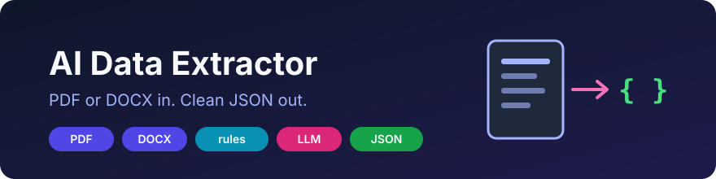
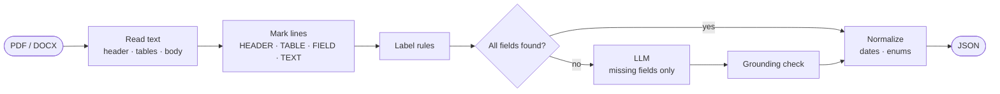

<div align="center">



# AI Data Extractor

**Pull structured fields out of PDF and Word documents.<br>Rules first for speed and certainty, an LLM only for what the rules miss.**


<table>
<tr>
<td align="center" width="33%"><h3>Rules first</h3>labels like <code>No. Dokumen:</code> read instantly<br><sub>no model call when rules find everything</sub></td>
<td align="center" width="33%"><h3>LLM fills gaps</h3>only for fields still missing<br><sub>any OpenAI-compatible endpoint</sub></td>
<td align="center" width="33%"><h3>Grounded</h3>every LLM value checked against the text<br><sub><code>verified: false</code> flags a guess</sub></td>
</tr>
</table>

**[Why](#why) · [Quick start](#quick-start) · [How it works](#how-it-works) · [n8n](#optional-n8n-workflow) · [Output](#output) · [Schema](#schema) · [Configuration](#configuration) · [Docs](#documentation)**

</div>

---

## Why

Document metadata lives in headers and control tables: number, title, owner, effective date, revision, approver. Typing it in by hand is slow, and sending the whole job to an LLM is slow, costly and occasionally invents values.

<table>
<tr>
<th width="50%">Document header</th>
<th width="50%">Extracted JSON</th>
</tr>
<tr>
<td valign="top">

```text
STANDARD OPERATING PROCEDURE
Data Backup and Restore

NO. DOKUMEN:        DOC-OPS 07.002
Mulai berlaku:      12 Agustus 2025
Revisi:             3.0
Departemen:         IT Operations
Disetujui oleh:     Head of IT
```

</td>
<td valign="top">

```json
{
  "document_number": "DOC-OPS 07.002",
  "effective_date":  "2025-08-12",
  "revision":        "3.0",
  "department":      "IT Operations",
  "approved_by":     "Head of IT",
  "title":           "Data Backup and Restore",
  "document_type":   "SOP"
}
```

</td>
</tr>
</table>

**Five fields from rules in microseconds. Two from the LLM, both found in the text.**

<sub>Illustrative example.</sub>

| | |
|---|---|
| **Fast where it can be** | Label rules read `Label: value`, table cells and label-on-one-line-value-on-the-next layouts |
| **Smart where it must be** | The LLM is asked only for the fields the rules could not find |
| **Honest about guesses** | LLM values that do not appear in the document come back with `verified: false` |
| **Clean values** | Indonesian and English dates become `YYYY-MM-DD`; enum fields snap to their allowed values |
| **Your fields, not ours** | Fields, labels and descriptions live in a JSON schema you can replace |
| **Works without a model** | No LLM configured: rules only, missing fields listed in `missing` |

## Quick start

**Requirements:** Go 1.25+ and `poppler` (`pdftotext`). An OpenAI-compatible chat endpoint is optional.

```bash
git clone https://github.com/llem0on/ai-data-extractor.git
cd ai-data-extractor
cp .env.example .env          # fill LLM_BASE_URL, LLM_API_KEY, LLM_MODEL
make run                      # http://localhost:8090
```

Extract from a file:

```bash
curl -s -F file=@procedure.pdf localhost:8090/extract | jq
```

Or straight from the command line:

```bash
make extract FILES="procedure.pdf policy.docx"
```

Or with Docker:

```bash
make docker
docker run -p 8090:8090 --env-file .env ai-data-extractor
```

<sub>On macOS: <code>brew install poppler</code>. On Debian/Ubuntu: <code>apt install poppler-utils</code>.</sub>

## How it works



1. **Read.** PDF text comes from `pdftotext` (first pages only, where the header lives). DOCX is read straight from its XML: page headers, table rows as `cell | cell`, then paragraphs.
2. **Mark.** Each line is tagged `[HEADER]`, `[TABLE]`, `[FIELD]`, `[HEADING]` or `[TEXT]`, which helps both the rules and the LLM understand the layout.
3. **Rules.** Every field has label patterns. A value is taken from `Label: value`, from the cell next to a label cell, or from the line after `Label:`.
4. **LLM.** Fields still missing go to the model in one call, with their descriptions and the marked text, at temperature 0 with JSON output.
5. **Ground and normalize.** LLM values are checked against the text, dates become ISO, and enums snap to their allowed values.

Details: [docs/how-it-works.md](docs/how-it-works.md)

## Optional: n8n workflow

The AI step can also run inside n8n instead of the service. The main benefit is **observability**: every extraction shows up in n8n's built-in execution dashboard with the input text, the model's answer, duration and errors, so a wrong field can be traced to its exact prompt and re-run without adding logging code.

<p align="center">
  
</p>

The workflow routes by file type, reads the text, skips scanned files with no text layer, lets an AI agent with a JSON output parser fill the header fields, derives rule-based fields in a code node and returns one JSON object.

Node-by-node details and a comparison with the built-in service: [docs/n8n.md](docs/n8n.md)

## Output

```json
{
  "document": { "name": "procedure.pdf", "format": "pdf" },
  "fields": {
    "document_number": { "value": "DOC-OPS 07.002", "source": "rule", "verified": true },
    "effective_date":  { "value": "2025-08-12",     "source": "rule", "verified": true },
    "title":           { "value": "Data Backup and Restore", "source": "llm", "verified": true },
    "prepared_by":     { "value": "J. Doe",         "source": "llm", "verified": false }
  },
  "missing": ["department"],
  "llm_used": true,
  "took_ms": 1840
}
```

| Field | Meaning |
|---|---|
| `source` | `rule` or `llm` |
| `verified` | `true` when the value appears in the document text |
| `missing` | Schema fields with no value |
| `llm_error` | Present when the LLM call failed; rule values are still returned |

Full API: [docs/api.md](docs/api.md)

## Schema

The default schema extracts eight fields: `document_type`, `document_number`, `title`, `department`, `effective_date`, `revision`, `prepared_by`, `approved_by`. Point `SCHEMA_PATH` at your own file to change them:

```json
{
  "fields": [
    {
      "name": "invoice_number",
      "description": "Invoice number printed on the document",
      "type": "string",
      "labels": ["invoice\\s*no\\.?", "nomor faktur"]
    },
    {
      "name": "due_date",
      "description": "Payment due date",
      "type": "date",
      "labels": ["due date", "jatuh tempo"]
    }
  ]
}
```

Field types: `string`, `date`, `enum`. Labels are case-insensitive regular expressions. See [docs/schema.md](docs/schema.md) and [examples/invoice.schema.json](examples/invoice.schema.json).

## Configuration

| Variable | Default | Purpose |
|---|---|---|
| `LLM_BASE_URL` | *(empty)* | OpenAI-compatible base URL, e.g. `http://localhost:4000/v1` |
| `LLM_API_KEY` | *(empty)* | Bearer token |
| `LLM_MODEL` | *(empty)* | Chat model; empty means rules only |
| `SCHEMA_PATH` | *(built-in)* | Custom schema file |
| `PDF_PAGES` | `2` | PDF pages to read from the start |
| `MAX_CHARS` | `6000` | Text sent to rules and LLM |

All variables: [docs/configuration.md](docs/configuration.md).

## Project layout

```text
cmd/
  server/        HTTP service
  extract/       command-line extractor, prints JSON
internal/
  document/      PDF and DOCX readers, line markers
  extract/       schema, label rules, LLM client, dates, grounding
  api/           HTTP handlers
  app/           wiring of schema and LLM client
  config/        environment variables
docs/            how it works, API, schema, configuration, n8n
examples/        example custom schema
```

## Documentation

| | |
|---|---|
| [How it works](docs/how-it-works.md) | Readers, line markers, rules, LLM step, grounding, normalization |
| [API](docs/api.md) | Endpoints, request and response shapes |
| [Schema](docs/schema.md) | Writing fields, labels and enums |
| [Configuration](docs/configuration.md) | Every environment variable |
| [n8n workflow](docs/n8n.md) | Optional AI step in n8n, with execution logs in the n8n dashboard |

## License

[MIT](LICENSE)
