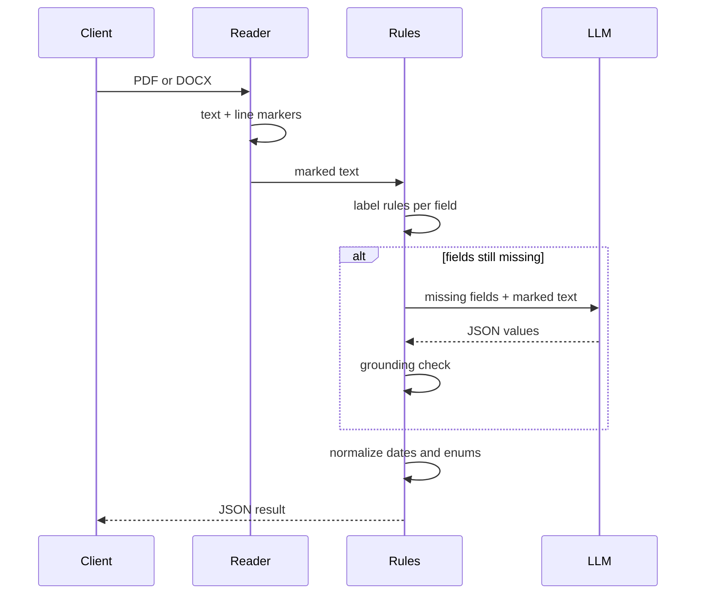

# How It Works

## 1. Readers

### PDF

`pdftotext` reads the first `PDF_PAGES` pages (default 2). Document metadata almost always sits on the first page, so reading the whole file only adds noise and LLM cost.

### DOCX

A `.docx` file is a zip of XML parts. The reader walks them directly, with no Word or LibreOffice needed:

| Part | Becomes |
|---|---|
| `word/header*.xml` | Lines prefixed `[HEADER]`; document headers often hold the control block |
| Table rows in `word/document.xml` | `[TABLE] cell | cell | cell` |
| Paragraphs | Plain lines |

Text split across formatting runs is joined, and compatibility fallbacks (`mc:Fallback`) are skipped so text is not counted twice.

## 2. Line markers

Every PDF line is tagged so the layout survives as plain text:

| Marker | Rule | Example |
|---|---|---|
| `[FIELD]` | `label: value`, label 3–40 characters | `[FIELD] Departemen : IT Operations` |
| `[HEADING]` | ≤ 60 characters, all caps | `[HEADING] STANDARD OPERATING PROCEDURE` |
| `[TEXT]` | everything else | `[TEXT] This procedure applies to...` |

## 3. Label rules

Each schema field has label patterns. A field is filled from the first match, in document order:

| Layout | Example | Value |
|---|---|---|
| Inline | `Revisi: 3.0` | `3.0` |
| Table cell | `[TABLE] No. Dokumen | DOC-01` | `DOC-01` |
| Next line | `NO. DOKUMEN:` then `DOC-01` | `DOC-01` |

A label must be followed by `:` or `-` when the value is on the same line, so a sentence such as *"Nomor revisi tercantum di tabel"* is not read as a document number. In table rows the label cell alone is enough.

## 4. LLM step

Runs only when at least one field is still empty and an LLM is configured.

- One request for all missing fields together, never for fields the rules already found.
- The prompt lists each field with its description, its allowed values for enums, and asks for dates in their original wording.
- `temperature: 0` and `response_format: json_object`. Answers wrapped in code fences are still parsed.
- If the call fails, the rule results are returned with `llm_error` set.

## 5. Grounding

An LLM can produce a plausible value that is not in the document. Every LLM value is compared with the document text, ignoring case and spacing:

| Result | `verified` |
|---|---|
| Value appears in the text | `true` |
| Value does not appear | `false` — treat as a suggestion, not a fact |

Rule values are always `verified: true`, since they were read from the text.

## 6. Normalization

| Type | Normalization |
|---|---|
| `date` | Indonesian and English month names and numeric formats become `YYYY-MM-DD`. Unparseable dates are returned unchanged |
| `enum` | Snaps to the allowed value it equals or contains, e.g. *Standard Operating Procedure (SOP)* → `SOP` |
| `string` | Whitespace collapsed, surrounding `:` and `-` trimmed |

Supported date inputs include `12 Agustus 2025`, `1 Des 2024`, `03/02/2025` (day first), `2025-08-12` and `January 5, 2025`.
