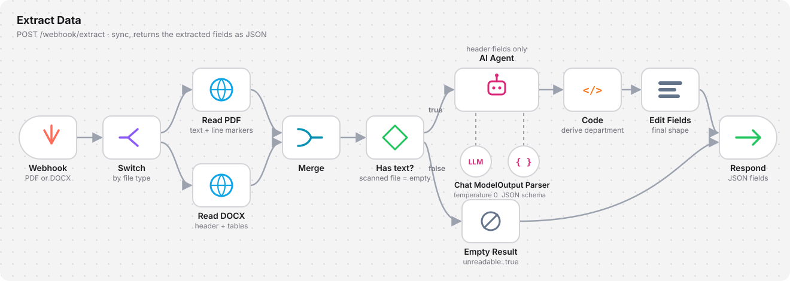

# Optional: n8n Workflow

The service extracts fields on its own: rules in Go, plus a direct call to an OpenAI-compatible endpoint. Running the AI step inside n8n instead is an optional approach.

| Benefit | Why it helps |
|---|---|
| **Logs out of the box** | Every extraction appears in n8n's execution dashboard with the input text, the model's answer, duration and errors. A wrong field can be traced back to its exact prompt and response, and re-run from the UI, without logging code |
| **Prompt outside the code** | Instructions and output schema are edited in the n8n editor, without a redeploy |
| **Visual post-processing** | Extra steps, such as deriving a field from another one, are added as nodes |

The trade-off is one more service to run and an extra network hop per document.

## Flow

<p align="center">
  
</p>

Runs **synchronously**: the caller uploads a file and waits for the JSON.

| Node | Does |
|---|---|
| **Webhook** | Receives the uploaded file as multipart form data |
| **Switch** | Routes by file extension, PDF or DOCX. Add a condition on an `env` query parameter to send development and production traffic to different readers |
| **Read PDF / Read DOCX** | HTTP Request to a reader that returns the document text with line markers (`[HEADER]`, `[TABLE]`, `[FIELD]`, `[HEADING]`, `[TEXT]`) |
| **Merge** | Joins both branches into one path |
| **Has text?** | Scanned PDFs have no text layer. Empty text skips the model entirely |
| **AI Agent** | Reads the marked text and returns only the header fields, guided by the system prompt |
| ↳ **Chat Model** | Any OpenAI-compatible chat model, temperature 0, JSON output |
| ↳ **Output Parser** | JSON schema the answer must follow, so missing keys become a parse error instead of silent gaps |
| **Code** | Derives fields that follow a rule, for example the department from the prefix of the document number |
| **Edit Fields** | Shapes the final object so every key is always present |
| **Empty Result** | Same keys, all empty, plus `unreadable: true`, so the caller can ask for a text-based file |
| **Respond** | Returns the JSON to the caller |

## Response

```json
{
  "output": {
    "document_type": "SOP",
    "title": "Data Backup and Restore",
    "document_number": "DOC-OPS 07.002",
    "effective_date": "12 Agustus 2025",
    "department": "IT Operations"
  }
}
```

For an unreadable file:

```json
{ "output": { "document_type": "", "title": "", "document_number": "", "effective_date": "", "department": "", "unreadable": "true" } }
```

## Built-in service vs n8n

| | Built-in (`POST /extract`) | n8n workflow |
|---|---|---|
| Label rules before the LLM | yes | no, the model reads every field |
| Grounding check on LLM values | yes | no |
| Execution logs and replay | application logs only | n8n dashboard |
| Prompt changes | edit schema descriptions, restart | edit in n8n, no restart |
| Extra moving parts | none | n8n |

Use the built-in service for speed and fewer model calls. Use n8n when traceability of every model answer matters more than latency.
